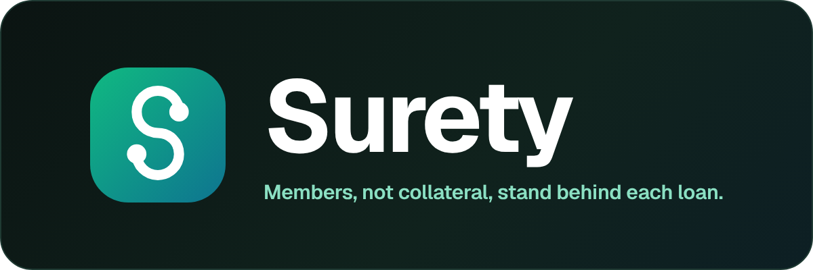
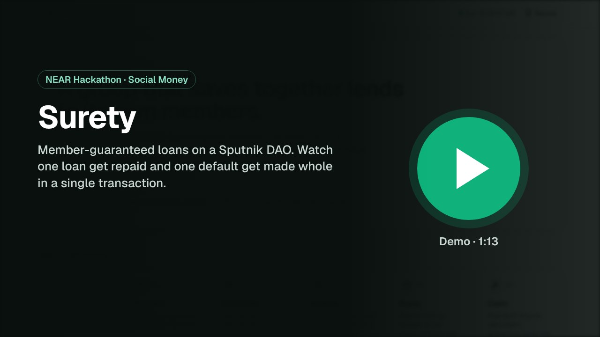
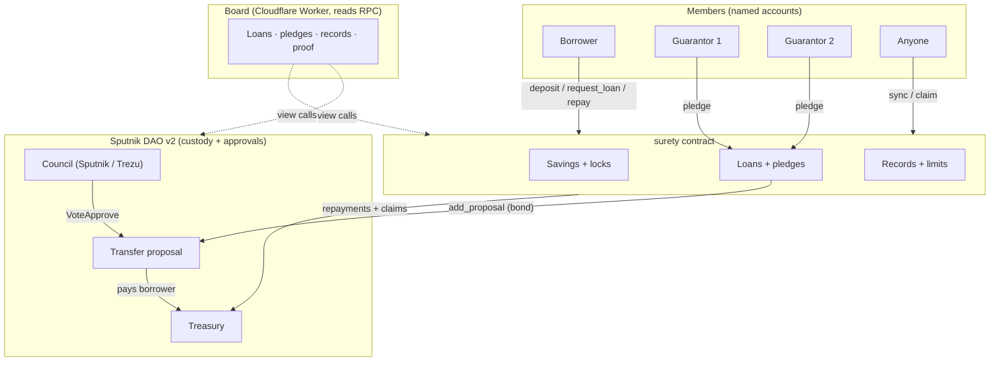
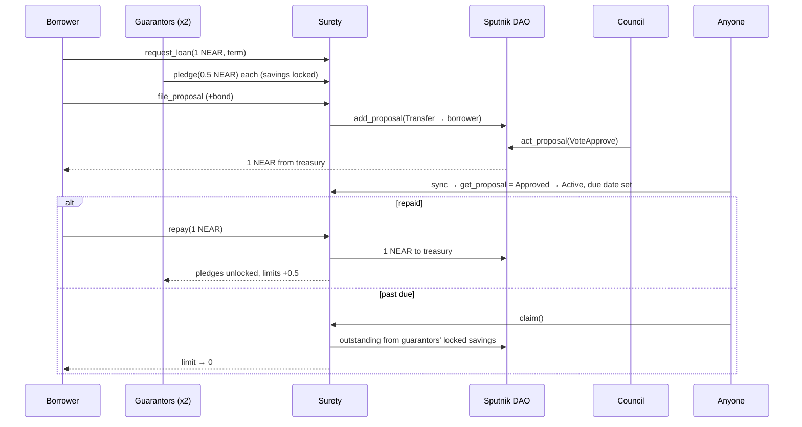
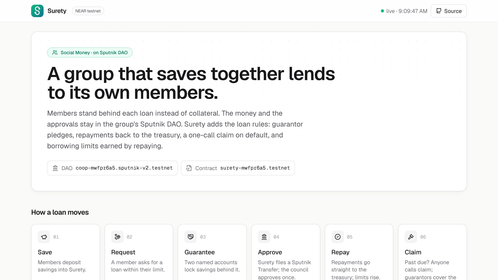
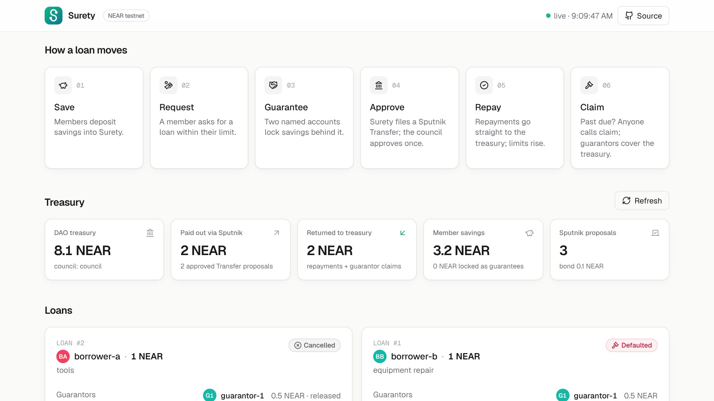
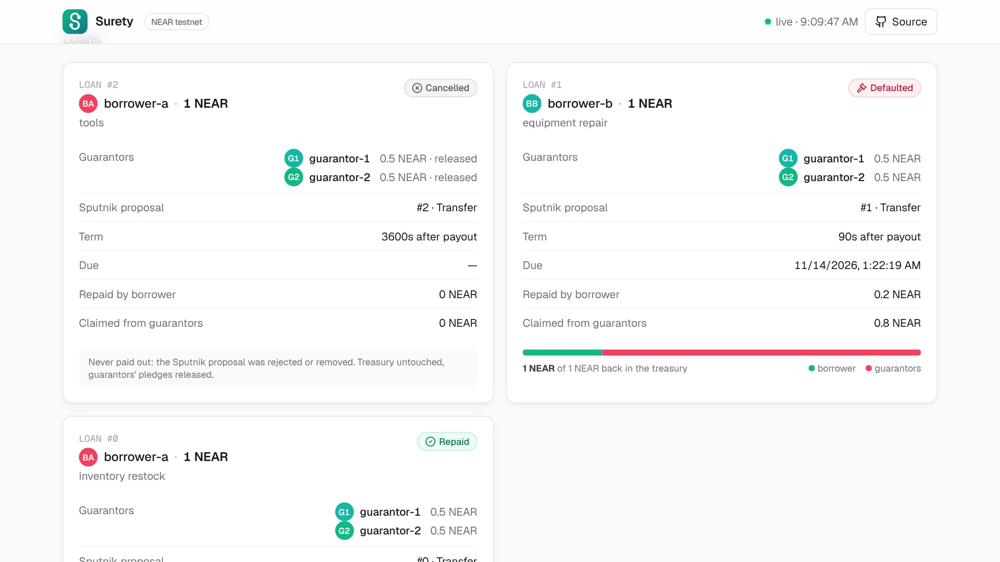
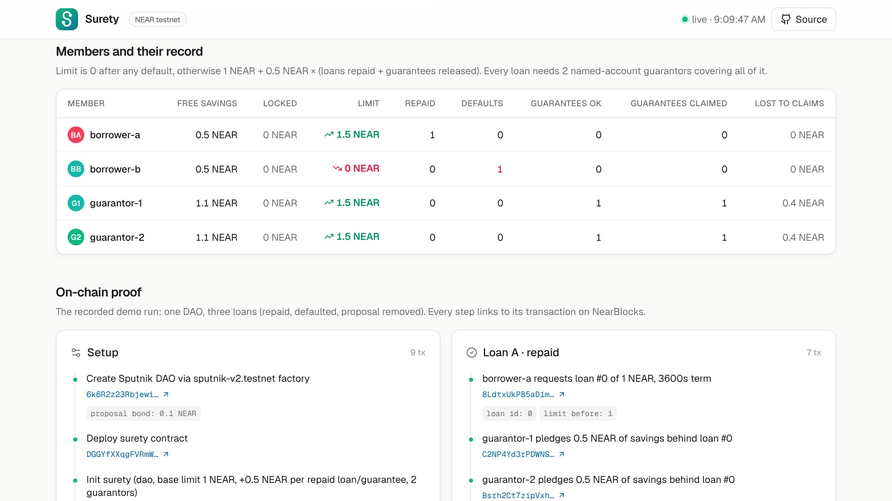
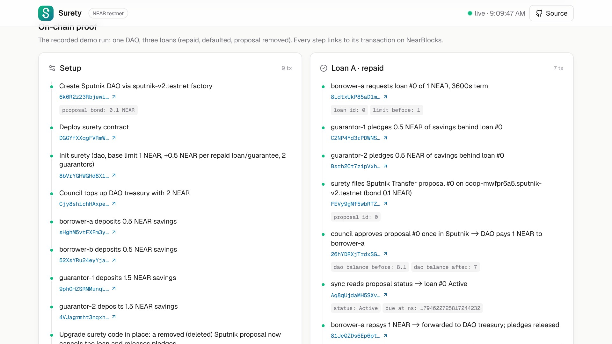
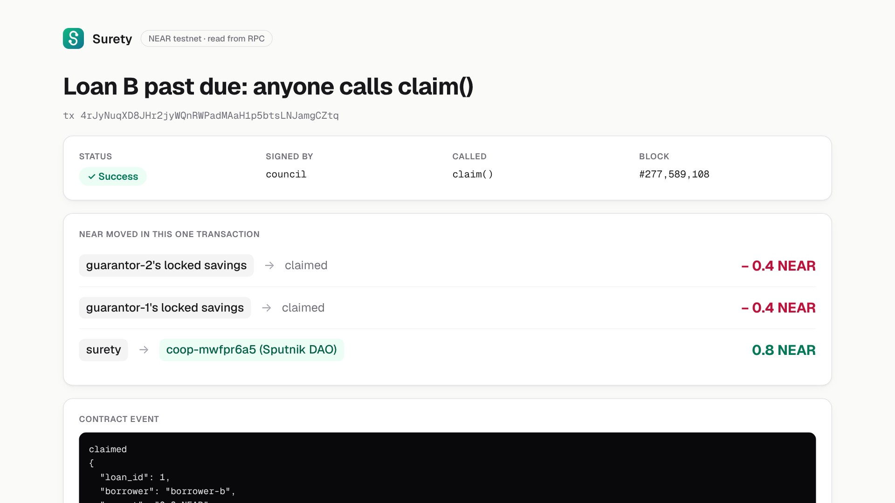

<div align="center">



### Members, not collateral, stand behind each loan.

A community that saves together can lend to its own members. Two members lock part of their savings behind each loan, the group's **Sputnik DAO** pays it out, and if it isn't repaid, one call makes the treasury whole from the guarantors.

*Surety* (n.): a person who takes responsibility for another's debt.

[](https://surety.ahmardchain.workers.dev/)
[](https://x.com/Ahmardchain/status/2121431624369705119)
[](https://x.com/Ahmardchain/status/2121431624369705119)

[](https://github.com/ahmardchain/surety/actions/workflows/test.yml)


</div>

| | |
|---|---|
| **Live board** | <https://surety.ahmardchain.workers.dev/> (reads the chain live) |
| **Demo video** | [1:13 on X, captions + voiceover](https://x.com/Ahmardchain/status/2121431624369705119) |
| **Source** | <https://github.com/ahmardchain/surety> |
| **Network** | NEAR testnet |
| **DAO** | [`coop-mwfpr6a5.sputnik-v2.testnet`](https://testnet.nearblocks.io/address/coop-mwfpr6a5.sputnik-v2.testnet) (official `sputnik-v2.testnet` factory) |
| **Contract** | [`surety-mwfpr6a5.testnet`](https://testnet.nearblocks.io/address/surety-mwfpr6a5.testnet) |
| **Stack** | Rust (near-sdk-rs) contract · Sputnik DAO v2 · static board on Cloudflare Workers |

Built for **[NEAR HACKATHON: Build Beyond Boundaries](https://nearhackathon.com)**, track **Social Money** ("build shared budgets, programmable rewards, collective ownership and reputation-based access on top of Sputnik DAO and Trezu").

## ❗ Problem

There are **2,195 DAOs** on the mainnet Sputnik factory `sputnik-dao.near` (`get_number_daos` at block 224,493,000). In every one of them, paying a member is a one-way `Transfer` proposal:

- Nothing on-chain links that payout to a repayment.
- No other member can stand behind the borrower.
- If the money doesn't come back, the group's only tools are chasing the person and holding another vote.

So a group that already pools money in a DAO still can't safely lend it to its own members, and the members who most need a loan are the ones without spare collateral to post.

## 💡 Solution

Surety is the missing loan layer, built **on** the group's Sputnik DAO instead of beside it:

- ✅ **Custody stays in the DAO.** Every payout is a normal Sputnik `Transfer` proposal that the council approves once, in Sputnik or Trezu. Surety never holds treasury funds.
- ✅ **Members guarantee each other.** Two **named-account** members lock part of their savings behind each loan, covering 100% of it.
- ✅ **Repayments go straight back** to the treasury and unlock the guarantors.
- ✅ **Defaults resolve in one call.** After the due date, **anyone** calls `claim()` and the guarantors' locked savings make the treasury whole in one transaction. No chasing, no bad-debt vote.
- ✅ **Access is earned.** Borrowing limits rise only with real repayments and drop to zero after a default.

## ⚡ Verify in 60 seconds (no install)

Two read-only calls to NEAR testnet RPC; needs only `curl` and `python3`.

```bash
curl -s https://rpc.testnet.near.org -H 'content-type: application/json' -d '{"jsonrpc":"2.0","id":1,"method":"query","params":{"request_type":"call_function","finality":"final","account_id":"surety-mwfpr6a5.testnet","method_name":"get_loans","args_base64":"e30="}}' | python3 -c 'import sys,json; from decimal import Decimal as D; [print(l["id"], l["status"], l["borrower"], "amount", D(l["amount"])/10**24, "repaid", D(l["repaid"])/10**24, "claimed", D(l["claimed"])/10**24) for l in json.loads(bytes(json.load(sys.stdin)["result"]["result"]))]'
```
**See:**
```
0 Repaid borrower-a-mwfpr6a5.testnet amount 1 repaid 1 claimed 0
1 Defaulted borrower-b-mwfpr6a5.testnet amount 1 repaid 0.2 claimed 0.8
2 Cancelled borrower-a-mwfpr6a5.testnet amount 1 repaid 0 claimed 0
```
```bash
curl -s https://rpc.testnet.near.org -H 'content-type: application/json' -d '{"jsonrpc":"2.0","id":1,"method":"query","params":{"request_type":"call_function","finality":"final","account_id":"surety-mwfpr6a5.testnet","method_name":"get_members","args_base64":"e30="}}' | python3 -c 'import sys,json; from decimal import Decimal as D; [print(m["account_id"], "limit", D(m["limit"])/10**24, "repaid", m["loans_repaid"], "defaults", m["loans_defaulted"], "locked", D(m["locked"])/10**24) for m in json.loads(bytes(json.load(sys.stdin)["result"]["result"]))]'
```
**See:**
```
borrower-a-mwfpr6a5.testnet limit 1.5 repaid 1 defaults 0 locked 0
borrower-b-mwfpr6a5.testnet limit 0 repaid 0 defaults 1 locked 0
guarantor-1-mwfpr6a5.testnet limit 1.5 repaid 0 defaults 0 locked 0
guarantor-2-mwfpr6a5.testnet limit 1.5 repaid 0 defaults 0 locked 0
```
That is the whole story in state: loan 0 repaid (borrower limit 1 → 1.5 NEAR, guarantors +0.5), loan 1 defaulted and made whole from guarantors (0.2 repaid + 0.8 claimed = 1 NEAR back), loan 2's proposal removed by the council (pledges released, nothing locked), defaulter's limit 0. Every step has a transaction link in [Live proof](#-live-proof-on-testnet).

**The deployed contract is exactly this source.** Build it and compare hashes:
```bash
cd contract && cargo build --target wasm32-unknown-unknown --release && python3 -c 'import hashlib;a="123456789ABCDEFGHJKLMNPQRSTUVWXYZabcdefghijkmnopqrstuvwxyz";n=int.from_bytes(hashlib.sha256(open("target/wasm32-unknown-unknown/release/surety.wasm","rb").read()).digest(),"big");o="";exec("while n:\n n,r=divmod(n,58);o=a[r]+o");print(o)'
```
**See:** `5pPo34mACSnJ9bPef6VsgqARYE7vhXpmD4EFUo7uZ2pn`, the same `code_hash` that `view_account` returns for `surety-mwfpr6a5.testnet` (Rust 1.86 is picked up from `contract/rust-toolchain.toml`).

## 🎬 Demo

<a href="https://x.com/Ahmardchain/status/2121431624369705119"></a>

<details open>
<summary><b>End-to-end demo on the live board (90 seconds)</b></summary>

1. Open <https://surety.ahmardchain.workers.dev/>. **See:** a "live" dot, and the DAO + contract links in the header.
2. **Treasury** row. **See:** 8 NEAR in the DAO, 2 NEAR paid out via Sputnik, 2 NEAR returned (repayments + guarantor claims).
3. **Loans.** **See:** Loan #0 *Repaid* (green bar, 1 of 1 NEAR back from the borrower), Loan #1 *Defaulted* (0.2 NEAR from the borrower + 0.8 NEAR from guarantors = 1 NEAR back), Loan #2 *Cancelled* ("never paid out", pledges released).
4. **Members and their record.** **See:** borrower-a's limit 1.5 NEAR ↑ (was 1), borrower-b 0 NEAR ↓ after the default, each guarantor 1.5 NEAR with 0.4 NEAR lost to the claim.
5. **On-chain proof.** Click any hash. **See:** the transaction on NearBlocks testnet.
6. **Do X → see Y.** Copy the `near` CLI commands to run your own loan against the same contract.

</details>

## Contents

[Problem](#-problem) · [Solution](#-solution) · [Core features](#-core-features) · [How Sputnik DAO, Trezu and named accounts are used](#-how-sputnik-dao-trezu-and-named-accounts-are-used) · [Architecture](#-architecture) · [Live proof](#-live-proof-on-testnet) · [Key design decision](#-key-design-decision-lend-through-the-daos-own-proposal) · [Screenshots](#-screenshots) · [Real vs. mock](#-whats-real-vs-mock) · [Hackathon criteria](#-hackathon-criteria) · [Tech stack](#-tech-stack) · [Getting started](#-getting-started) · [Contract API](#-contract-api) · [Project structure](#-project-structure) · [Roadmap](#-roadmap)

## 🧩 Core features

### 🐖 Savings
Members `deposit()` NEAR into Surety. Free savings can be withdrawn at any time; savings locked as a guarantee cannot.

### 🤝 Member guarantees instead of collateral
A borrower calls `request_loan(amount, duration_sec)`, capped by their limit. At least **two named-account guarantors** must `pledge()` until 100% of the loan is covered. The borrower can't guarantee their own loan, and implicit (64-hex / 0x) accounts are rejected, so every guarantee is tied to a readable identity.

### 🏛️ Payout through the DAO
`file_proposal()` makes Surety call the DAO's own `add_proposal` with a plain `Transfer` (treasury → borrower), attaching the DAO's bond. The council approves once, in Sputnik or Trezu. `sync()` reads the outcome: *Approved* starts the repayment clock; *Rejected*, *Expired* or *Removed* cancels the loan and releases the pledges.

### 💸 Repayment straight to the treasury
`repay()` forwards every yoctoNEAR to the DAO and refunds any overpayment. Full repayment unlocks the guarantors and raises everyone's limit.

### ⚖️ One-call default
After the due date anyone calls `claim()`. The outstanding balance moves from the guarantors' locked savings to the DAO **pro rata to their pledges**, with exact rounding (a 256-bit `mul_div` avoids u128 overflow). The borrower's limit drops to 0.

### 📈 Reputation-based access

| Event | Borrower | Guarantors |
|---|---|---|
| Loan repaid in full | `loans_repaid +1` → limit +0.5 NEAR | `guarantees_released +1` → limit +0.5 NEAR |
| Loan defaulted and claimed | `loans_defaulted +1` → **limit 0** | `guarantees_claimed +1`, `claimed_from_me` recorded |

`limit = 0` after any default, otherwise `base_limit + limit_step × (loans_repaid + guarantees_released)`. This deployment uses 1 NEAR base and 0.5 NEAR per step.

## 🔗 How Sputnik DAO, Trezu and named accounts are used

| Piece | What Surety does with it | When | Code |
|---|---|---|---|
| **Sputnik DAO v2** `add_proposal` | Files a `Transfer { token_id: "", receiver_id: borrower, amount }` with the exact policy bond; description carries `ref surety:<contract>:loan:<id>` | Loan fully guaranteed | [`file_proposal`](contract/src/lib.rs#L311) |
| **Sputnik DAO v2** `get_proposal` | Reads `status` (Approved / Rejected / Expired); a deleted proposal is treated as Removed | Anyone calls `sync` | [`sync`, `on_proposal_status`](contract/src/lib.rs#L353) |
| **Sputnik DAO v2** treasury | Receives every repayment and every default claim as a plain NEAR transfer | `repay`, `claim` | [`repay`](contract/src/lib.rs#L379), [`claim`](contract/src/lib.rs#L412) |
| **Sputnik DAO v2** policy | Unchanged default roles: `Everyone` may add proposals, `council` votes (threshold 1/2), bond 0.1 NEAR | DAO creation | [`scripts/setup.js`](scripts/setup.js) |
| **Trezu** | Surety's proposals are ordinary Sputnik `Transfer`s, which is what Trezu lists as payment requests, so the council approves loans where it already works. No Trezu code is changed. | Council approval | n/a |
| **Named accounts** | Borrowers and guarantors must be named accounts; limits and records are keyed by them | Every write | [`is_named`](contract/src/lib.rs#L143) |

**Engineering notes**
- The default Sputnik policy lets *Everyone* add proposals, so a contract can be a proposer. The bond comes back to Surety on Approve, Reject and Expire, and Surety refunds whoever paid it.
- `add_proposal` asserts the bond is **exact**, so `file_proposal` forwards the caller's attached deposit unchanged; a wrong amount fails in the DAO and Surety's callback reopens the loan and refunds.
- Sputnik **deletes** removed proposals, so `get_proposal` panics afterwards. Surety treats that as Removed; an approved proposal is never deleted, so this can't cancel a paid-out loan.

## 🏗️ Architecture





## 📜 Live proof on testnet

One DAO, three loans: **A** repaid, **B** defaulted and claimed, **C** proposal removed by the council. All 30 transactions were sent by `scripts/setup.js`, `scripts/demo.js` and `scripts/demo-removed.js`; the raw log with balances before and after is [`demo/txs.json`](demo/txs.json).

| What | Account |
|---|---|
| Sputnik DAO | [`coop-mwfpr6a5.sputnik-v2.testnet`](https://testnet.nearblocks.io/address/coop-mwfpr6a5.sputnik-v2.testnet) |
| Surety contract | [`surety-mwfpr6a5.testnet`](https://testnet.nearblocks.io/address/surety-mwfpr6a5.testnet) |
| Council (only DAO voter) | `council-mwfpr6a5.testnet` |
| Borrowers | `borrower-a-mwfpr6a5.testnet` (A, C), `borrower-b-mwfpr6a5.testnet` (B) |
| Guarantors on every loan | `guarantor-1-mwfpr6a5.testnet`, `guarantor-2-mwfpr6a5.testnet` |

**Key moments**
- **Step 15, Loan A repaid:** the `loan_repaid` event shows borrower-a's `new_limit` = 1.5 NEAR, up from 1.
- **Step 23, Loan B claimed:** one transaction; the `claimed` event shows 0.4 NEAR from each guarantor and 0.8 NEAR to the DAO, which goes from 7.2 back to 8 NEAR.
- **Steps 24–30, Loan C removed:** the council votes *Remove*, Sputnik deletes the proposal and pays nothing; `sync` treats it as Removed, cancels the loan and releases both 0.5 NEAR pledges.
- **Steps 12 / 19 / 28:** the filed proposals are ordinary Sputnik `Transfer`s: `near view coop-mwfpr6a5.sputnik-v2.testnet get_proposal '{"id":1}'`.

<details>
<summary><b>All 30 transactions</b></summary>

| # | Step | Tx |
|---|---|---|
| 1 | Create Sputnik DAO via sputnik-v2.testnet factory | [6k6R2z23Rb…](https://testnet.nearblocks.io/txns/6k6R2z23RbjewibWoZg9ad8GZrUskTHmH8pFGUUJU3CU) |
| 2 | Deploy surety contract | [DGGYfXXqgF…](https://testnet.nearblocks.io/txns/DGGYfXXqgFVRmWDYr4JWmrT344SjYhM78TbgDcziqidw) |
| 3 | Init surety (dao, base limit 1 NEAR, +0.5 NEAR per repaid loan/guarantee, 2 guarantors) | [8bVrYGHWGH…](https://testnet.nearblocks.io/txns/8bVrYGHWGHd8X1pMvjdrALRvu26KVUYoDJgePxfWwtqc) |
| 4 | Council tops up DAO treasury with 2 NEAR | [Cjy8shichH…](https://testnet.nearblocks.io/txns/Cjy8shichHAxpeu48ZHARVaDTguL7FMGsyRUshvuyGns) |
| 5 | borrower-a-mwfpr6a5.testnet deposits 0.5 NEAR savings | [sHghM5vtFX…](https://testnet.nearblocks.io/txns/sHghM5vtFXFm3yRCH6GKxjXhPNc1eUucBknBAd2vesH) |
| 6 | borrower-b-mwfpr6a5.testnet deposits 0.5 NEAR savings | [52XsYRu24e…](https://testnet.nearblocks.io/txns/52XsYRu24eyYja3MZmUq5i899AKyYqiWqPm6tSzxcktC) |
| 7 | guarantor-1-mwfpr6a5.testnet deposits 1.5 NEAR savings | [9phGHZSRMM…](https://testnet.nearblocks.io/txns/9phGHZSRMMunqLrraZEWTmNpfQfmiLpGdZe28Uy7z252) |
| 8 | guarantor-2-mwfpr6a5.testnet deposits 1.5 NEAR savings | [4VJagrmht3…](https://testnet.nearblocks.io/txns/4VJagrmht3nqxhUbpPf2jF9dBj8VZ3iednEYUSjA5iHr) |
| 9 | Loan A: borrower-a-mwfpr6a5.testnet requests loan #0 of 1 NEAR, 3600s term | [8LdtxUkP85…](https://testnet.nearblocks.io/txns/8LdtxUkP85aD1mrfyceTX5sH8VEYLhxLCAN2uTnBJgh7) |
| 10 | Loan A: guarantor-1-mwfpr6a5.testnet pledges 0.5 NEAR of savings behind loan #0 | [C2NP4Yd3rP…](https://testnet.nearblocks.io/txns/C2NP4Yd3rPDWNS5XKDBzv55grHUYzfJ6eCTULhwMXWpf) |
| 11 | Loan A: guarantor-2-mwfpr6a5.testnet pledges 0.5 NEAR of savings behind loan #0 | [Bsrh2Ct7zi…](https://testnet.nearblocks.io/txns/Bsrh2Ct7zipVxhyutWGhzehnoEYMQRoxJGLSdNNt2uwg) |
| 12 | Loan A: surety files Sputnik Transfer proposal #0 on coop-mwfpr6a5.sputnik-v2.testnet (bond 0.1 NEAR) | [FEVy9gMf5w…](https://testnet.nearblocks.io/txns/FEVy9gMf5wbRTZhFk2XjBAxQf3SDPyEFzGq6ZzAcVBax) |
| 13 | Loan A: council approves proposal #0 once in Sputnik -> DAO pays 1 NEAR to borrower-a-mwfpr6a5.testnet | [26hYDRXjTr…](https://testnet.nearblocks.io/txns/26hYDRXjTrdxSGakPsv75Kx4rzhhr99nwtVHHKEh5qj6) |
| 14 | Loan A: sync reads proposal status -> loan #0 Active | [Aq8qUjdaMH…](https://testnet.nearblocks.io/txns/Aq8qUjdaMH5SXvAuA6XWMtDu1tMGvXG9UbQNzhMR8BDA) |
| 15 | Loan A: borrower-a-mwfpr6a5.testnet repays 1 NEAR -> forwarded to DAO treasury; pledges released | [81JeQZDs6E…](https://testnet.nearblocks.io/txns/81JeQZDs6Ep6pt2fuzeXc5JSBkW9d3JS938nLwsQMLUJ) |
| 16 | Loan B: borrower-b-mwfpr6a5.testnet requests loan #1 of 1 NEAR, 90s term | [GXVmcVwpHe…](https://testnet.nearblocks.io/txns/GXVmcVwpHe88TYfrum6hN9LJZ9HBSvab9RwdRfRnvwKZ) |
| 17 | Loan B: guarantor-1-mwfpr6a5.testnet pledges 0.5 NEAR of savings behind loan #1 | [FUT4aqxFJv…](https://testnet.nearblocks.io/txns/FUT4aqxFJv4WDiUR5ECo2RZ4ZcnyYR6jPJetNB7jZij) |
| 18 | Loan B: guarantor-2-mwfpr6a5.testnet pledges 0.5 NEAR of savings behind loan #1 | [FbnRRz5sW5…](https://testnet.nearblocks.io/txns/FbnRRz5sW5wjidgbBS8TX2aPr33ArsHtAd2dz5mtuv1f) |
| 19 | Loan B: surety files Sputnik Transfer proposal #1 on coop-mwfpr6a5.sputnik-v2.testnet (bond 0.1 NEAR) | [9SiGfr2YpC…](https://testnet.nearblocks.io/txns/9SiGfr2YpChuq5xXSKUJn7pveetrYbR3NouuZZDmhU66) |
| 20 | Loan B: council approves proposal #1 once in Sputnik -> DAO pays 1 NEAR to borrower-b-mwfpr6a5.testnet | [4diqL6dnVd…](https://testnet.nearblocks.io/txns/4diqL6dnVdKsXrSJbBU4J1BD5nqXRREvPdzPEHMYAQFP) |
| 21 | Loan B: sync reads proposal status -> loan #1 Active | [2Kmn47hoUx…](https://testnet.nearblocks.io/txns/2Kmn47hoUxCc8JZV12x2zD2GMpDC3GFKotWLsA6V2e2p) |
| 22 | Loan B: borrower-b-mwfpr6a5.testnet repays only 0.2 NEAR, then stops | [A2V2byrGYy…](https://testnet.nearblocks.io/txns/A2V2byrGYyvuwH7EW1SrDV6mBGhPtVujWhGFeBijPaVz) |
| 23 | Loan B: past due -> claim moves guarantors' locked savings (0.8 NEAR) to DAO treasury in one call | [4rJyNuqXD8…](https://testnet.nearblocks.io/txns/4rJyNuqXD8JHr2jyWQnRWPadMAaH1p5btsLNJamgCZtq) |
| 24 | Upgrade surety code in place: a removed (deleted) Sputnik proposal now cancels the loan and releases pledges | [dBH2JtdVSS…](https://testnet.nearblocks.io/txns/dBH2JtdVSSgdLfSa14MY3mD4iyQifP3Z2PPeRm3wNYz) |
| 25 | Loan C: borrower-a-mwfpr6a5.testnet requests loan #2 of 1 NEAR (uses the 1.5 NEAR limit earned in Loan A) | [CEwzkVDKGW…](https://testnet.nearblocks.io/txns/CEwzkVDKGWkxSBcakRwYAtQByzp1xstY8JDmcD48Ervv) |
| 26 | Loan C: guarantor-1-mwfpr6a5.testnet pledges 0.5 NEAR behind loan #2 | [DKRc8f6r4n…](https://testnet.nearblocks.io/txns/DKRc8f6r4nCV2Kip6UgsWLpcYqBrhfzgTxvZEynhJog2) |
| 27 | Loan C: guarantor-2-mwfpr6a5.testnet pledges 0.5 NEAR behind loan #2 | [BycF8t2zQ5…](https://testnet.nearblocks.io/txns/BycF8t2zQ51GTmy7xrAhfwxgXE464Yuj8uN594yvo2bE) |
| 28 | Loan C: surety files Sputnik Transfer proposal #2 | [CnShsZUG6d…](https://testnet.nearblocks.io/txns/CnShsZUG6dvgMXNeo93VeHMbWgqyWnGASiqsUyyzi9fJ) |
| 29 | Loan C: council votes Remove on proposal #2; Sputnik deletes it, no payout | [3NEviLGMnx…](https://testnet.nearblocks.io/txns/3NEviLGMnxEDC8SCqhfdC7SkcTxdcFDaE8aVv63q2ESN) |
| 30 | Loan C: sync finds the proposal gone -> loan #2 Cancelled, guarantors' pledges released | [DroToC372E…](https://testnet.nearblocks.io/txns/DroToC372EiT8NrJS5DFgrwaBpHcLHaiNPsBQ1ni26Td) |

</details>

## 🔑 Key design decision: lend through the DAO's own proposal

The obvious ways to build community lending each break something:

- ❌ **Surety holds the loan pool.** That rebuilds custody and a second multisig next to the DAO: exactly what the track says not to do.
- ❌ **The council pays from the DAO and tracks loans in a spreadsheet.** Nothing links payout to repayment, and a default is a social problem with no on-chain remedy.
- ❌ **Collateralised loans.** The members who most need a loan are the ones without spare collateral.

Surety never touches treasury funds. It only *asks* the DAO to pay, in the DAO's own format, once guarantors have locked their savings:

```rust
// contract/src/lib.rs, file_proposal
let kind = json!({"Transfer": {
    "token_id": "",                 // native NEAR from the DAO treasury
    "receiver_id": loan.borrower,
    "amount": loan.amount,
    "msg": Value::Null
}});
ext_dao::ext(self.dao.clone())
    .with_attached_deposit(bond)    // must equal the DAO's proposal_bond
    .add_proposal(ProposalInput { description, kind })
    .then(Self::ext(me).on_proposal_filed(loan_id))
```

The council keeps its veto (approve, reject or remove in Sputnik or Trezu), the treasury keeps custody, and the guarantee is enforceable on-chain because the guarantors' savings are already locked in Surety when the vote happens.

## 🖼️ Screenshots

| | |
|---|---|
|  **Live board**: DAO and contract, read from chain |  **How a loan moves + treasury totals** |
|  **Loans**: repaid, defaulted (split bar), cancelled |  **Records and limits**: 1.5 ↑ after repaying, 0 ↓ after default |
|  **On-chain proof**: every step links to its tx |  **The claim**: −0.4 NEAR from each guarantor, +0.8 NEAR to the DAO, one tx |

## 🧾 What's real vs. mock

| Part | Status |
|---|---|
| Surety contract on NEAR testnet, 30 recorded transactions | ✅ Real, verifiable with the quickstart above |
| Sputnik DAO | ✅ Real, unmodified Sputnik v2 from the official `sputnik-v2.testnet` factory |
| Council approvals | ✅ Real `act_proposal` votes by the council account (scripted) |
| Repayments and default claim | ✅ Real NEAR moved to the DAO treasury |
| Board numbers | ✅ Live RPC view calls, no cached or seeded data |
| Members | 🛠️ Demo accounts created from the testnet faucet with role names; actions sent by `scripts/demo*.js` |
| Loan terms | 🛠️ Shortened for the demo (Loan B: 90 seconds) |
| Trezu | 🛠️ Not shown on testnet: hosted Trezu reads mainnet DAOs only; its repo has a dev mock for testnet ([nt-fe README](https://github.com/NEAR-DevHub/trezu/blob/main/nt-fe/README.md)) |
| Money | Testnet NEAR only, no real value |

## ✅ Hackathon criteria

| Requirement | Met | Where |
|---|---|---|
| Public repo + LICENSE (Q-014) | ✅ | MIT, [`LICENSE`](LICENSE) |
| README a machine can follow: product, problem, "do X → see Y" (§1 Procedure) | ✅ | [Verify in 60 seconds](#-verify-in-60-seconds-no-install), [Getting started](#-getting-started) |
| Demo post on X with video, tags @NEARProtocol #NEARHackathon | ✅ | [X post](https://x.com/Ahmardchain/status/2121431624369705119) |
| Testnet-only is eligible (Q-010) | ✅ | Sputnik DAO and Surety both on testnet |
| Other entry named (Q-015) | ✅ | [PreSafe](#other-near-hackathon-entry-by-the-same-author-q-015), and PreSafe's README names Surety |
| Code written in the window (Q-001) | ✅ | All commits on 2026-11-14; nothing reused |
| Libraries / AI listed (Q-005) | ✅ | [Tech stack](#-tech-stack) |
| No secrets in history | ✅ | Keys live only in `KEYS_DIR`, outside the repo |
| Track: build on **Sputnik DAO**, don't rebuild the multisig | ✅ | Payouts are the DAO's own `Transfer` proposals; [key design decision](#-key-design-decision-lend-through-the-daos-own-proposal) |
| Track: **reputation-based access** | ✅ | Limits from real repayments; 0 after default |
| Track: **shared budgets / collective ownership** | ✅ | Pooled treasury lends to members; members' savings jointly back each loan |
| Track: **named accounts** | ✅ | Enforced for borrowers and guarantors (`is_named`) |
| Track: **Trezu** | ✅ | Loans are approved as standard Transfer requests, the same flow Trezu shows |

## 🧰 Tech stack

| Layer | Tech |
|---|---|
| Contract | Rust, near-sdk-rs 5.24.1 (pinned with Rust 1.86 for nearcore-compatible wasm) |
| DAO | Sputnik DAO v2 via `sputnik-v2.testnet` factory (unmodified) |
| Scripts | Node 22, near-api-js 5.1 |
| Board | Static HTML, Tailwind CSS 3.4 + Lucide icons compiled at build time, Geist font; hosted on Cloudflare Workers |
| Video | Playwright screen recording, Microsoft Edge neural TTS (`en-US-AndrewNeural`), ffmpeg |
| CI | GitHub Actions: `cargo test` + wasm build + board build |
| AI | Built with Claude Code |

## 🚀 Getting started

**Prerequisites:** Rust (rustup picks 1.86 from `contract/rust-toolchain.toml`), Node 22, Python 3.

```bash
git clone https://github.com/ahmardchain/surety && cd surety
```
```bash
cd contract && cargo test
```
**See:** `19 passed`. The tests cover limits, pledging rules, full cover and 2-guarantor checks, repay → limit rise, pro-rata claim with exact rounding, rejected and removed proposals, failed filing, stale callbacks, and locked savings that cannot be withdrawn.
```bash
cargo build --target wasm32-unknown-unknown --release
```
```bash
cd ../scripts && npm ci
```
Then move `demo/state.json` and `demo/txs.json` aside, so the scripts don't reuse the recorded accounts:
```bash
KEYS_DIR=$HOME/.surety-keys node setup.js
```
```bash
KEYS_DIR=$HOME/.surety-keys node demo.js
```
**See:** `setup.js` creates six named accounts from the testnet faucet, a new Sputnik DAO, deploys and initializes Surety, and funds the treasury. `demo.js` runs Loan A (repaid) and Loan B (defaulted and claimed after 90 s) and writes a fresh `demo/txs.json`; `demo-removed.js` adds Loan C (proposal removed). Keys are written only to `KEYS_DIR`. If your network needs a proxy, run Node with `NODE_USE_ENV_PROXY=1`.

**Run the board locally:** `python3 -m http.server 8765` in the repo root, then open <http://127.0.0.1:8765/web/>. Add `?contract=<id>` to point it at another deployment. `node scripts/build-worker.js` builds the deployed version into `web/dist/`; `CF_API_TOKEN=… ./scripts/deploy-cf.sh` publishes it.

**Run your own loan by hand** with the `near` CLI: the board's *Do X → see Y* section lists every call (deposit → request_loan → pledge ×2 → file_proposal → council `act_proposal` → sync → repay *or* wait and claim) with what changes after each. Expected failures you can trigger:
- requesting above your limit → `amount exceeds your limit`
- pledging on your own loan → `borrower cannot guarantee own loan`
- filing with one guarantor → `not enough guarantors`
- claiming early → `loan is not past due`

### Environment variables

All optional.

| Variable | Used by | Purpose |
|---|---|---|
| `KEYS_DIR` | `scripts/*.js` | Where account keys are written and read (default `scripts/.keys`, git-ignored). Keep it outside the repo. |
| `SUFFIX` | `setup.js` | Account-name suffix for a fresh deployment |
| `NEAR_RPC` | `scripts/lib.js` | RPC URL (default `https://rpc.testnet.near.org`) |
| `LOAN_B_SECONDS` | `demo.js` | Loan B term (default 90) |
| `NODE_USE_ENV_PROXY` | Node | Set to `1` behind an HTTPS proxy |
| `CF_API_TOKEN`, `CF_ACCOUNT_ID`, `WORKER_NAME` | `deploy-cf.sh` | Publish the board to Cloudflare Workers |

## 📘 Contract API

[`contract/src/lib.rs`](contract/src/lib.rs) · tests in [`contract/src/tests.rs`](contract/src/tests.rs)

| Method | Who | Effect |
|---|---|---|
| `new(dao, base_limit, limit_step, min_guarantors)` | deployer | Bind to one Sputnik DAO |
| `deposit()` payable | member | Add free savings |
| `withdraw(amount)` | member | Withdraw free (unlocked) savings |
| `request_loan(amount, duration_sec, purpose?)` | named member | Open a loan ≤ limit; one in-progress loan per borrower |
| `pledge(loan_id, amount)` / `unpledge(loan_id)` | named member ≠ borrower | Lock or unlock savings behind an open loan |
| `cancel_loan(loan_id)` | borrower | Cancel before filing; unlocks pledges |
| `file_proposal(loan_id)` payable (= DAO bond) | anyone | `add_proposal` Transfer on the DAO |
| `sync(loan_id)` | anyone | Read `get_proposal`; activate or cancel |
| `repay(loan_id)` payable | anyone | Forward to the DAO treasury; excess refunded |
| `claim(loan_id)` | anyone, after due | Guarantors' locked savings → DAO treasury, pro rata |
| `get_config`, `get_member`, `get_members`, `get_loan`, `get_loans`, `get_limit` | view | |

Events are NEP-297-style `EVENT_JSON` logs: `deposit`, `withdraw`, `loan_requested`, `pledged`, `unpledged`, `proposal_filed`, `proposal_failed`, `loan_active`, `repaid`, `loan_repaid`, `claimed`, `loan_cancelled`.

**Limits of this version**
- Native NEAR only; a stablecoin version would use the same `Transfer` with `token_id`.
- No interest or fees.
- The due date starts when `sync` sees *Approved*, not at the DAO's payout block; anyone can call `sync` right after the vote.
- A default takes the guarantors' pledges only. The borrower's own savings aren't seized, but their limit goes to 0.
- `request_loan` scans all loans to enforce one in-progress loan per borrower; a per-borrower index is the fix at scale.
- Surety can't change the DAO's policy or move treasury funds. Removing it means the DAO stops approving its proposals.

## 🗂️ Project structure

```
surety/
├── contract/                 Rust contract (near-sdk-rs)
│   ├── src/lib.rs            savings, loans, pledges, Sputnik calls, claim, limits
│   ├── src/tests.rs          19 unit tests
│   └── rust-toolchain.toml   Rust 1.86 pin for nearcore-compatible wasm
├── scripts/
│   ├── setup.js              faucet accounts, Sputnik DAO, deploy + init, fund treasury
│   ├── demo.js               Loan A (repaid) and Loan B (defaulted + claimed)
│   ├── demo-removed.js       code upgrade + Loan C (proposal removed)
│   ├── lib.js                near-api-js helpers, tx log
│   ├── build-web.js          compiles Tailwind + inlines icons → web/dist/
│   ├── build-worker.js       bundles the board into a Cloudflare Worker
│   ├── deploy-cf.sh          publishes the Worker
│   └── video/                make.sh rebuilds the demo video
├── web/index.html            the board (source)
├── demo/                     state.json (accounts) + txs.json (30 recorded txs)
├── docs/                     logo, demo thumbnail, screenshots
└── .github/workflows/        CI
```

## 📚 Documentation

- [`SUBMISSION.md`](SUBMISSION.md): the submission's public fields and checklist
- [`DEMO-SCRIPT.md`](DEMO-SCRIPT.md): video storyboard and narration
- [`X-POST.md`](X-POST.md): the launch post
- [`FEEDBACK.md`](FEEDBACK.md): builder feedback for the Sputnik DAO, Trezu and NEAR tooling teams
- [`CHANGELOG.md`](CHANGELOG.md)

## 🧭 Roadmap

- Stablecoin loans (NEP-141 `Transfer` with `token_id`).
- Repayment schedules (instalments) instead of a single due date.
- Optional interest that flows to the treasury as a shared budget.
- Seize the borrower's own savings first, before the guarantors'.
- Per-borrower loan index; paginated views.
- Mainnet DAO so the council can approve loans in hosted Trezu.

## Other NEAR Hackathon entry by the same author (Q-015)

This author's second, independent NEAR HACKATHON project is **PreSafe**: <https://presafe.ahmardchain.workers.dev/> ([repo](https://github.com/ahmardchain/presafe)). Surety and PreSafe share no code and are submitted separately.

## Builder

**Ahmard** · X [@ahmardchain](https://x.com/ahmardchain) · Telegram [@ahmardchain](https://t.me/ahmardchain) · GitHub [ahmardchain](https://github.com/ahmardchain) · [Launch post](https://x.com/Ahmardchain/status/2121431624369705119)

---

<div align="center">


**Surety.** Members, not collateral, stand behind each loan.

Testnet demo with role-named test accounts; no real money is at risk.<br/>
Licensed under [MIT](LICENSE).

</div>
